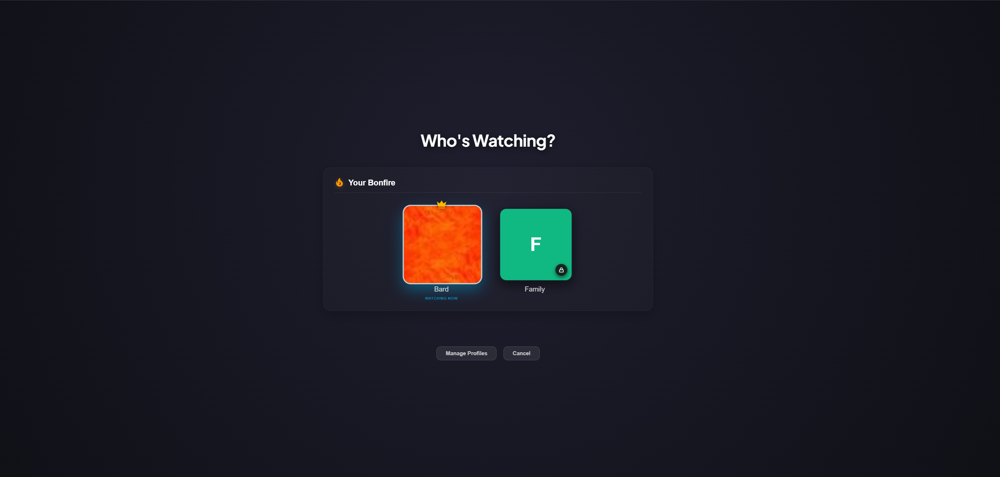
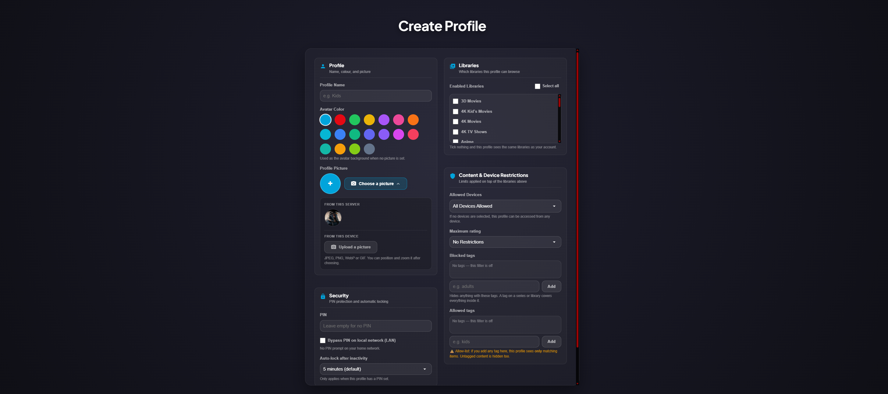

# Bonfire/JellyProfiles

Profiles for Jellyfin. One account holds several people, each with their own watch
history, library access and parental controls.

Works with Jellyfin 10.11 and 12.0.



## Features

- **Up to 20 profiles per account.** The default is five. Administrators can change the
  limit for the whole server or for one account.
- **Parental controls the server enforces.** Library access, rating limits and tag
  filters are applied by Jellyfin itself, so they hold in every app, including apps that
  can't show the switcher.
- **PINs.** Lock any profile with a PIN. You can skip it on your home network.
- **Device limits.** Keep a profile to the devices you choose.
- **Shared Bonfires.** Link two accounts with a 6-character code so both households
  appear on one switcher.
- **Avatars.** Thirty built in, plus any pictures you upload for the whole server.
- **Per-profile library artwork.** A Kids profile can show its own picture for a library
  instead of a poster from a film it can't open.
- **Your choice of switcher.** A Bonfire button in the header or a **Switch Profile**
  entry in Jellyfin's own menu, with an optional "Who's watching?" screen on startup.



## Install

1. In the Jellyfin dashboard, open **Plugins → Repositories** and add:
   ```
   https://ahouseofbards.github.io/Bonfire-JellyProfiles/manifest.json
   ```
2. Install **Bonfire/JellyProfiles** from **Plugins → Catalog**.
3. Restart Jellyfin.

Nothing else to set up. If the switcher doesn't appear, see
[TROUBLESHOOTING.md](TROUBLESHOOTING.md). Beta builds are in
[BETA-CHANNEL.md](BETA-CHANNEL.md).

## Apps

**Full support:** Jellyfin Web, Jellyfin for Android, Jellyfin Media Player, LG webOS
4.5 and later, and Samsung Tizen
([one-time setup](TROUBLESHOOTING.md#samsung-tizen)).

**Profile sign-in:** Jellyfin for Android TV, Roku, Swiftfin, Findroid and Wholphin can
list your profiles on their own sign-in screen. Turn it on under
**Dashboard → Bonfire → TVs & Apps**, and turn off automatic sign-in in the app. Type
the profile's PIN where the app asks for a password. Android TV is confirmed on hardware;
the others are not yet.

Details for every app are in [docs/clients.md](docs/clients.md).

## Documentation

- [Sharing a Bonfire](docs/sharing.md)
- [Library artwork](docs/library-artwork.md)
- [Apps and what works on each](docs/clients.md)
- [Security](docs/security.md)
- [Limitations](docs/limitations.md)
- [Troubleshooting](TROUBLESHOOTING.md)
- [Changelog](CHANGELOG.md)
- [Developer API](docs/developer-api.md)

## License

MIT. See [LICENSE](LICENSE).

Starter avatars are [Fluent Emoji](https://github.com/microsoft/fluentui-emoji) by
Microsoft, under the MIT License
([notice](Web/starter-avatars/LICENSE.txt)).
