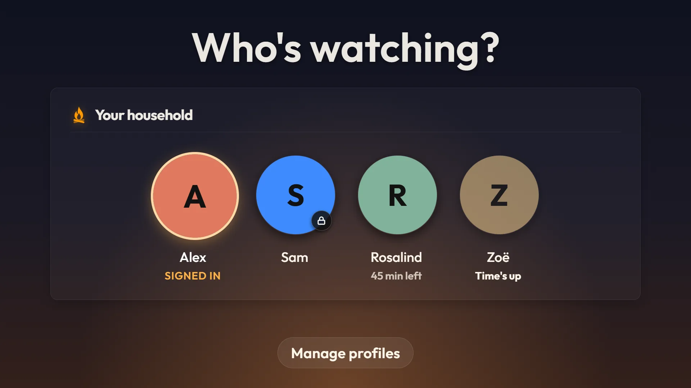
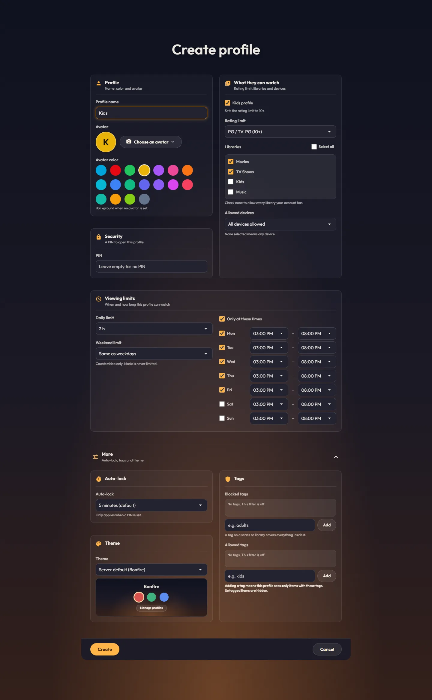
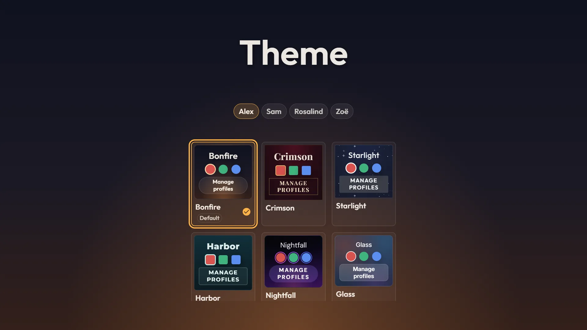
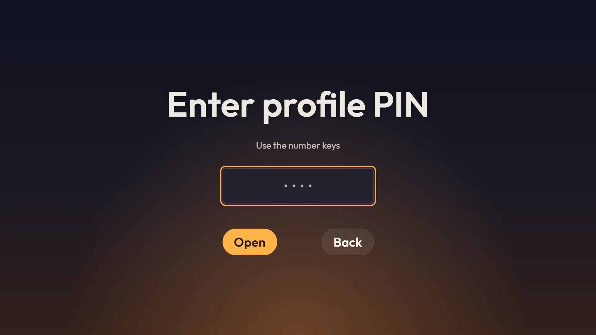
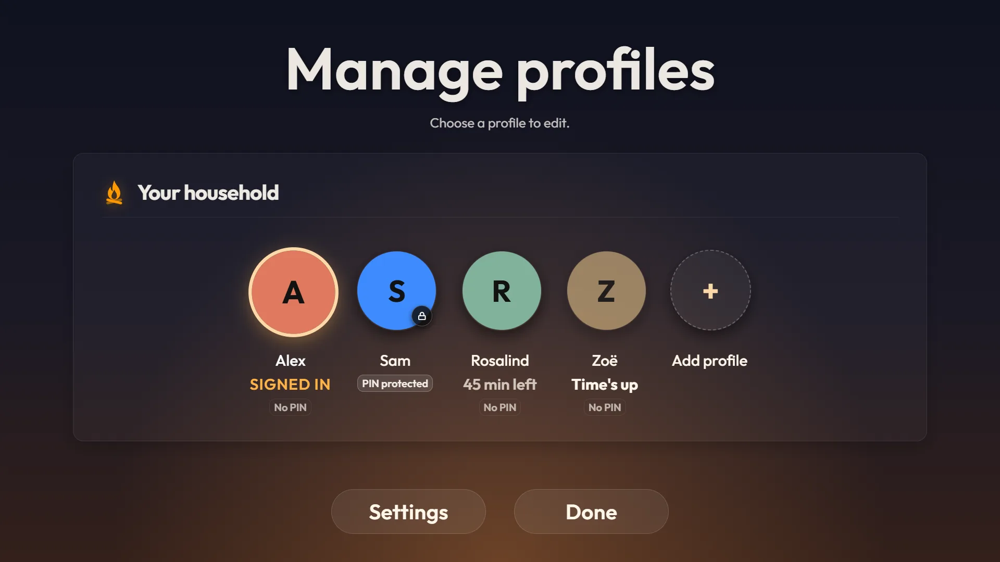

# Bonfire


Profiles for Jellyfin. One account holds several people, each with their own watch
history, library access and parental controls.

Works with Jellyfin 10.11 and 12.0. Part of [Campground](https://github.com/AHouseOfBards/Campground-Jellyfin), a set of plugins for Jellyfin.



## Features

- **Up to 20 profiles per account.** The default is five. Administrators can change the
  limit for the whole server or for one account.
- **Parental controls the server enforces.** Library access, rating limits and tag
  filters are applied by Jellyfin itself, so they hold in every app, including apps that
  can't show the switcher. Rating limits use your server country's ratings.
- **PINs.** Lock any profile with a PIN. You can skip it on your home network.
- **Device limits.** Keep a profile to the devices you choose.
- **Shared Bonfires.** Link two accounts with a 6-character code so both households
  appear on one switcher.
- **Avatars.** Thirty built in, plus any images you upload for the whole server.
- **Per-profile library artwork.** A Kids profile can show its own image for a library
  instead of a poster from a film it can't open.
- **Themes.** Twelve looks for Bonfire's screens, including high contrast and two that match
  Jellyfin's own light and dark themes. Each profile can
  have its own, set from **Settings → Theme** on the main account. Administrators choose
  the default and can turn choosing off.
- **Your choice of switcher.** A Bonfire button in the header or a **Switch profile**
  entry in Jellyfin's own menu, with an optional "Who's watching?" screen on startup.
- **Six languages.** English, Catalan, French, Polish, Spanish and Turkish, following the
  language set in Jellyfin. [Add yours](Web/i18n/README.md).

## Install

1. In Jellyfin, open **Dashboard → Plugins → Repositories** and add Campground's repository:
   ```
   https://ahouseofbards.github.io/Campground-Jellyfin/manifest.json
   ```
2. Install **Bonfire** from **Dashboard → Plugins → Catalog**.
3. Restart Jellyfin.

Nothing else to set up. If the switcher doesn't appear, see
[troubleshooting](docs/troubleshooting.md). Beta builds are in
[the beta channel guide](docs/beta-channel.md).

## Apps

**Full support:** Jellyfin Web, Jellyfin for Android, Jellyfin for iOS (iPhone and iPad),
Jellyfin Media Player, LG webOS 4.5 and later, and Samsung Tizen
([one-time setup](docs/troubleshooting.md#samsung-tizen)).

**Profile sign-in:** Jellyfin for Android TV, Roku, Swiftfin, Findroid and Wholphin can
list your profiles on their own sign-in screen. Turn it on under
**Dashboard → Plugins → Bonfire → Clients**, and [set the app to ask every time](docs/clients.md#profile-sign-in). Type
the profile's PIN where the app asks for a password. Android TV is confirmed on hardware;
the others are not yet.

**Profile picker (beta):** Moonfin shows a Profiles folder on its home screen
([how it works](docs/clients.md#profile-picker-beta)). It's off by default and may change when native support arrives.

Details for every app, and what each can do, are in [Apps](docs/clients.md#what-each-app-can-do).

## Screenshots









## Documentation

Also at [ahouseofbards.github.io/Bonfire-JellyProfiles](https://ahouseofbards.github.io/Bonfire-JellyProfiles/), with search.

- [Using Bonfire](docs/profiles.md)
- [Admin guide](docs/admin-guide.md)
- [Sharing a Bonfire](docs/sharing.md)
- [Library artwork](docs/library-artwork.md)
- [Apps and what works on each](docs/clients.md)
- [Security](docs/security.md)
- [Limitations](docs/limitations.md)
- [Troubleshooting](docs/troubleshooting.md)
- [Changelog](CHANGELOG.md)
- [Developer API](docs/developer-api.md)
- [API reference](docs/api.html)

Bonfire is written with assistance from artificial intelligence models, but is still primarily built, tested and maintained by me, Bards.

## License

MIT. See [LICENSE](LICENSE).

Starter avatars are [Fluent Emoji](https://github.com/microsoft/fluentui-emoji) by
Microsoft, under the MIT License
([notice](Web/starter-avatars/LICENSE.txt)).

The theme fonts are Atkinson Hyperlegible Next, Baloo 2, Bebas Neue, Cinzel, Comfortaa, DM Sans,
Figtree, Fraunces, Inter, JetBrains Mono, Lexend, Lora, Manrope, Merriweather, Montserrat,
Noto Sans, Nunito, Oswald, Outfit, Playfair Display, Plus Jakarta Sans, Press Start 2P,
Quicksand and Righteous, under the SIL Open Font License. Each license text is in
[Web/themes/fonts](Web/themes/fonts).
